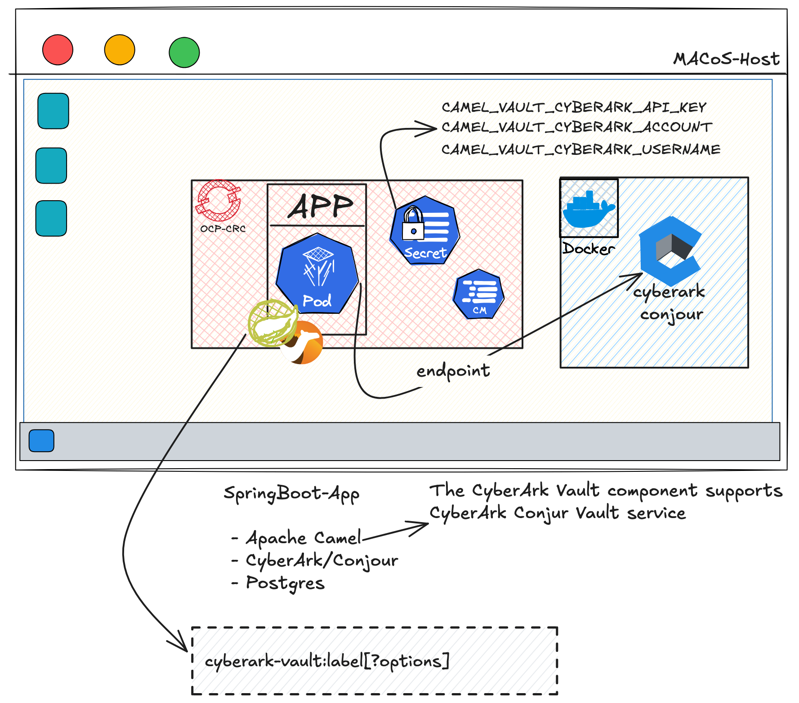
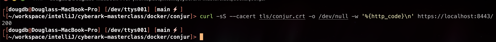
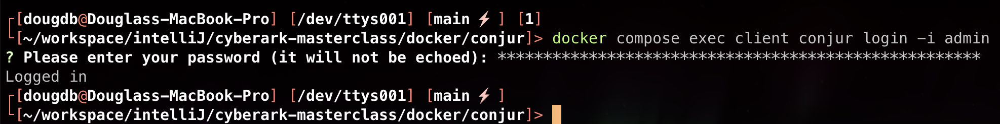
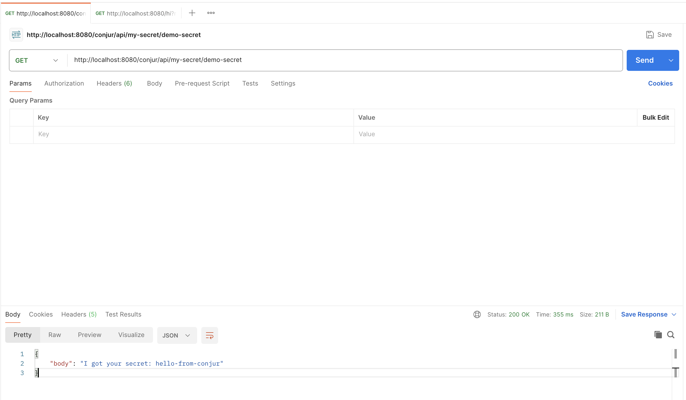
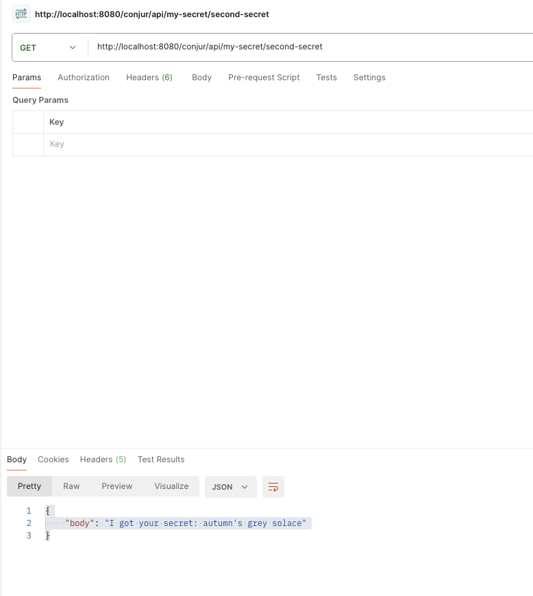

= CyberArk Conjur + Apache Camel: Integration PoC
Douglas Batista
:toc: left
:toclevels: 2
:icons: font
:source-highlighter: rouge

== 1. Objective

Validate, end to end, how a Spring Boot + Apache Camel application reads and writes secrets in an *external* CyberArk Conjur server using token-based, application-identity authentication.
The identity model mirrors the AppID / Safe / Object mindset used in the corporate CyberArk estate.

The PoC runs locally first (Maven on the Mac, Conjur in Docker) and is then migrated to OpenShift CRC.

.Success criteria
* The app authenticates against Conjur with a host identity and reads a secret through the Camel `cyberark-vault` component.
* Secrets are accessed with short-lived Conjur access tokens; the host API key is only exchanged for a token (see section 5.4).
* The app creates/updates a secret value in Conjur through the same component.
* The same app runs on OCP CRC with credentials injected from a Kubernetes Secret into environment variables.
No credential lives in the image or in Git.
* Every phase is documented and reproducible.

=== Audience: who does what

The PoC is written for two audiences: Conjur/OpenShift administrators and application developers.

[cols="1,3"]
|===
|Role |Responsibility in this PoC

|Admin (Conjur / platform)
|Runs Conjur and its TLS proxy, loads the policy (host, variables, permissions), hands the host API key to OpenShift as a Secret and the certificate as a ConfigMap, and owns the network path between the Pod and Conjur. Permission errors (HTTP 403) and connectivity problems are handled here, not in the application.

|Developer (application)
|Configures the Camel `cyberark-vault` component (`url`, `account`, `username`, `api-key` from environment variables) and writes routes that set the secret id and the operation (`getSecret` / `createSecret`). The application never handles the API key in code.
|===

== 2. Scope

[cols="1,1"]
|===
|In scope |Out of scope

a|
* Conjur OSS via Docker Compose (TLS proxy, pinned image tags)
* Camel `cyberark-vault` producer: `getSecret` and `createSecret`
* Migration to OpenShift CRC with Conjur external
a|
* Production hardening (HA, HSM, rotation, Conjur Enterprise/Followers)
* The corporate PAM/CCP (AIMWebService) API; it is a different API from Conjur's
* Persisting data in a database (JPA/PostgreSQL were dropped from the PoC)
* Automated integration tests (`mvn verify`); the flows are verified manually with `curl` and documented with evidence
* Application resilience (token refresh handling, retries, `onException`); the component behaviour is documented, not hardened
|===

== 3. Target architecture

[cols="1,3"]
|===
|Component |Role

|MacOS host
|Runs Docker (Conjur) and OCP CRC. Phases 1-2 run the app directly with Maven; phase 3 runs it as a Pod in CRC.

|CyberArk Conjur OSS
|External secrets server (Docker Compose: Conjur, TLS proxy). Lives *outside* the cluster on purpose, like the corporate Vault.

|OCP CRC
|Single-node OpenShift. Runs the Spring Boot app Pod.

|Spring Boot app
|Apache Camel routes. Camel is the only layer that talks to Conjur.

|===

== 4. Core premises

. *Local first.* Validate everything with Maven + Docker before touching OCP.
. *Conjur stays external to the cluster*, reached through an endpoint on the Mac (from the Pod, the Mac LAN IP; see section 11.3).
. *Camel is the only integration path to Conjur.* No hand-written HTTP client in business code.
. *No credentials in code, image or Git.* Environment variables locally; Kubernetes Secret injected as env vars on OCP.
. *Pinned image tags.* No `latest` in committed files.
Phase 1 pins `cyberark/conjur:1.27.0`, `postgres:15-alpine`, `nginx:1.28-alpine` and `cyberark/conjur-cli:8`.
. *TLS on.* The proxy uses a self-signed certificate and the JVM trusts it through a truststore (`javax.net.ssl.trustStore`): a local file on the Mac, a ConfigMap mounted in the Pod on OCP.
The component options `certificatePath` and `verifySsl=false` had no effect in this setup (Camel 4.22.2), so neither is relied on (see section 11.6).
. *Document each phase before starting the next.*

== 5. Identity and authentication

=== 5.1 Corporate model vs. Conjur model

[cols="1,1,2"]
|===
|Corporate CyberArk (CCP/AAM) |Conjur (this PoC) |Notes

|AppID
|Host identity (`host/<app>`)
|The application identity. Authenticates with an API key (or JWT) and receives a short-lived access token.

|Safe
|Policy branch (e.g. `poc/app`)
|Grouping and permission boundary. One branch holds many variables.

|Object / Account name
|Variable id (e.g. `poc/app/cipher-key`)
|The secret itself. A variable must be declared in policy before a value can be written to it.

|Account (tenant)
|Conjur account (e.g. `myConjurAccount`)
|Required by the Camel component (`account`).
|===

NOTE: If the corporate environment uses CCP/AAM, this PoC validates the Conjur model and the Camel integration pattern.
A CCP call would need a different component (for example `camel-http`).

=== 5.2 What the Camel component supports (4.22.x docs)

* Producer only (since Camel 4.17).
* Operations: `getSecret` (default) and `createSecret`, set in the URI or with header `CamelCyberArkVaultOperation`.
* `createSecret` takes the value from the message body and the id from header `CamelCyberArkVaultSecretId`. It sets the value of an *existing* variable; it does not create variables or policy branches (observed: HTTP 404 `not_found` for an undeclared variable).
* Secret id: URI option `secretId` or header `CamelCyberArkVaultSecretId`.
* Authentication: username + password, username + API key, or a pre-authenticated `authToken` (which takes precedence when present).
* Connection options: `url`, `account`, `verifySsl`, `certificatePath`, and `conjurClient` (a custom client bean from the registry). Observed in 4.22.2: `certificatePath` and `verifySsl=false` do not change the TLS behaviour of the client (PKIX errors persist); the JVM truststore does.
* Property function: `+{{cyberark:path/to/var}}+` and `+{{cyberark:path#jsonField}}+`, fed by `CAMEL_VAULT_CYBERARK_*` environment variables.

=== 5.3 Authentication decision

[cols="1,2,1"]
|===
|Option |Description |Decision

|A. Host + API key
|`username=host/<app>` + `apiKey`, injected as env vars (K8s Secret on OCP). The component exchanges it for an access token.
|*Adopted* for phases 1-3

|B. Static `authToken`
|Token obtained outside the app and injected.
|Rejected: Conjur access tokens are short-lived

|C. `authn-jwt` with the Pod's service account token
|Custom `ConjurClient` bean that authenticates with the projected token. No long-lived secret in the cluster.
|Stretch goal (post phase 4)
|===

The API key is a long-lived credential, but it is never used to read secrets: it is exchanged for a short-lived access token, and only the token calls the Conjur API (section 5.4).

=== 5.4 How authentication works: short-lived access tokens

The application proves its identity with the host API key and receives an *access token* that expires quickly. Jenkins parallel: the API key is like a service account password, and the access token is like a short-lived session obtained with it.

.Authentication flow
[cols="1,3"]
|===
|Step |What happens

|1. Identity
|The host `poc/app` is declared in policy (`docker/conjur/policy/poc.yml`); its login is `host/poc/app`.

|2. Credential
|Loading the policy generates the host API key (`poc_app_data`). On OCP it lives in the Kubernetes Secret `conjur-credentials` and reaches the Pod as the environment variable `CAMEL_VAULT_CYBERARK_API_KEY`.

|3. Authenticate
|`POST /authn/<account>/<login>/authenticate` with the API key in the request body, over TLS. Conjur answers with a signed access token (JSON).

|4. Use the token
|The token is Base64-encoded and sent as `Authorization: Token token="<base64>"` on every secrets call (`GET /secrets/<account>/variable/<id>` to read, `POST` to set a value). The API key is not sent again.

|5. Expiry
|The token is short-lived (minutes). After it expires Conjur answers 401 and the client must authenticate again; the component does this by itself, and this PoC does not test it.

|6. Authorization
|What the token can do is defined by policy: `read`, `execute` and `update` on the `poc/app` variables (section 6.3). Nothing else is reachable with it.
|===

.The same flow with `curl` (this is what `docker/conjur/smoke-test.sh` does)
[source,bash]
----
API_KEY=$(grep -oE '"api_key": ?"[^"]+"' poc_app_data | cut -d'"' -f4)

# 1. Exchange the API key for a short-lived access token
TOKEN=$(curl -sS --cacert tls/conjur.crt -X POST --data "$API_KEY" \
  https://localhost:8443/authn/myConjurAccount/host%2Fpoc%2Fapp/authenticate | base64 | tr -d '\r\n')

# 2. Use the token, not the API key, to read a secret
curl -sS --cacert tls/conjur.crt -H "Authorization: Token token=\"$TOKEN\"" \
  https://localhost:8443/secrets/myConjurAccount/variable/poc%2Fapp%2Fdemo-secret
----

In the application, the Camel `cyberark-vault` component performs steps 3 and 4 internally from `username` (`host/poc/app`) and `api-key`. The stack trace of a failed call shows `retrieveSecret` calling `authenticate`, so the component seems to authenticate on each call; token caching was not confirmed.

NOTE: The access token is short-lived, but the host API key is not. Removing the long-lived key from the cluster requires `authn-jwt` with the Pod service account token (option C above, a stretch goal).

== 6. Application design

=== 6.1 Configuration contract

`application.yml` reads these environment variables; the local defaults point to the Docker Conjur, and OCP overrides them from a Kubernetes Secret.

[cols="2,3"]
|===
|Environment variable |Meaning

|`CAMEL_VAULT_CYBERARK_URL`
|Conjur base URL (TLS proxy)

|`CAMEL_VAULT_CYBERARK_ACCOUNT`
|Conjur account name

|`CAMEL_VAULT_CYBERARK_USERNAME`
|Host identity, e.g. `host/poc/app`

|`CAMEL_VAULT_CYBERARK_API_KEY`
|Host API key (from the Kubernetes Secret on OCP)

|`CAMEL_VAULT_CYBERARK_VERIFY_SSL`
|Wired to `verify-ssl`; no observed effect on the TLS handshake (see 5.2), so TLS is handled by the truststore
|===

=== 6.2 Flows

. *Read from Conjur* (implemented): REST `GET /conjur/api/my-secret/{name}` -> Camel route `direct:conjur-get` -> `cyberark-vault` `getSecret` on `poc/app/{name}` -> response.
. *Write to Conjur* (implemented): REST `POST /conjur/api/my-secret/save` with `{"secretPath": "...", "secretValue": "..."}` -> Camel route `seda:conjur-save` -> `cyberark-vault` `createSecret` on `poc/app/{secretPath}`.
The id is sent without a leading slash. The route is asynchronous, so a failed save only shows in the application log.

=== 6.3 Conjur policy

A policy file in the repo (`docker/conjur/policy/poc.yml`) declares the host (`poc/app`), the variables (`poc/app/cipher-key`, `poc/app/demo-secret`, `poc/app/second-secret`) and the permissions (`read`, `execute`, `update`) the host needs.

Responsibilities are split on purpose:

* *Admin / policy:* creates branches and variables and grants permissions.
* *Application (`host/poc/app`):* authenticates, reads and updates values on the variables it has permission for.

`createSecret` only succeeds on variables declared in the policy. To add a secret, add a `- !variable app/<name>` line to `poc.yml` and reload the policy.

== 7. Roadmap

[cols="1,3,1"]
|===
|Phase |Deliverable |Status

|1
|Conjur OSS in Docker Compose (pinned tags, TLS proxy, account, policy, host API key). Smoke test with curl.
|Done

|2
|Local app (`mvn spring-boot:run`): Camel `getSecret` / `createSecret`, verified manually with `curl`.
|Done

|3
|Migration to OCP CRC: image built in the cluster, Conjur reached from the Pod, credentials via Kubernetes Secret, truststore via ConfigMap.
|Done (GET and POST verified through the Route)

|4
|Final documentation and evidence (screenshots).
|Next
|===

== 8. Repository layout

[source]
----
cyberark-masterclass/
├── pom.xml                  # parent: BOMs, plugins, shared dependencies
├── README.adoc
├── thumbs/                  # screenshots and architecture image
├── docker/
│   └── conjur/              # Conjur OSS stack (phase 1)
│       ├── docker-compose.yml
│       ├── conf/            # nginx proxy + openssl config
│       ├── policy/          # Conjur policy (poc.yml)
│       ├── smoke-test.sh    # host auth + read, via curl
│       ├── tls/             # generated certs and truststore (git-ignored)
│       ├── .env             # local secrets (git-ignored)
│       ├── admin_data       # admin API key (git-ignored)
│       └── poc_app_data     # host API key (git-ignored)
├── openshift/               # OCP manifests (phase 3), applied with oc apply -f
│   ├── configmap/
│   │   └── conjur-truststore.yaml   # generated per environment from the local certificate (git-ignored)
│   └── deployment/
│       └── conjur.yaml              # Deployment + Service + Route
└── conjur/                  # Spring Boot + Camel module
    ├── Dockerfile           # JRE 25 + the Spring Boot jar
    └── pom.xml
----

== 9. Open points

* `certificatePath` and `verifySsl=false` have no effect with Camel 4.22.2; the JVM truststore is used instead (confirmed on the Mac and on OCP). Source-level confirmation is still pending.
* On OCP the certificate SAN has no Mac IP, so hostname verification is disabled with a JVM flag. The proper fix is a certificate with the IP or a fixed name (for example `conjur.poc.local` plus `hostAliases`) in the SAN.
* The Mac LAN IP comes from DHCP; if it changes, the Deployment URL must be updated.
* Whether the component caches the access token between calls, and how it behaves when a token expires (see 5.4). Resilience is out of scope for this PoC.
* The save route is asynchronous (`seda`), so a `201` does not prove the write; reading the value back does.
* Optional extra: a separate provisioning identity (for example `host/poc/provisioner`) with policy permissions, so the application identity keeps access to secrets only.
* Stretch goal: `authn-jwt` with the Pod service account token instead of a host API key.

== 10. Hands-on log (phases 1 and 2)

=== 10.1 Phase 1: Conjur OSS in Docker

.Local secrets, TLS certificate and stack (from `docker/conjur`)
[source,bash]
----
# Random DB passwords and the Conjur data key (git-ignored .env)
printf 'CONJUR_DB_PASSWORD=%s\nAPP_DB_PASSWORD=%s\n' "$(openssl rand -hex 16)" "$(openssl rand -hex 16)" > .env
printf 'CONJUR_DATA_KEY=%s\n' "$(docker run --rm cyberark/conjur:1.27.0 data-key generate)" >> .env

# Self-signed certificate for the proxy (SAN: localhost, proxy, 127.0.0.1)
mkdir -p tls && openssl req -x509 -newkey rsa:2048 -nodes -days 365 -keyout tls/conjur.key -out tls/conjur.crt -config conf/openssl.cnf

docker compose up -d
docker compose ps

# TLS check through the proxy, without -k
curl -sS --cacert tls/conjur.crt -o /dev/null -w '%{http_code}\n' https://localhost:8443/
----

image::thumbs/docker-composeUP.png[Stack up]

image::thumbs/curl_log-dckUp.png[Proxy logs]

.Conjur account and CLI (the admin API key goes to a git-ignored file)
[source,bash]
----
docker compose exec conjur conjurctl account create myConjurAccount > admin_data
docker compose exec client conjur init -u https://proxy -a myConjurAccount --self-signed
docker compose exec client conjur login -i admin
----

.Policy, host identity and smoke test
[source,bash]
----
# The host API key goes to a git-ignored file
docker compose exec client conjur policy load -b root -f /policy/poc.yml > poc_app_data

# Authenticates as host/poc/app and reads poc/app/demo-secret through the TLS proxy
bash smoke-test.sh
----

image::thumbs/apiKeyHost_test.png[Host authentication smoke test]

=== 10.2 Phase 2: read a secret through Camel

.Create a secret value, build the truststore and run the app
[source,bash]
----
# From docker/conjur
docker compose exec client conjur variable set -i poc/app/demo-secret -v "hello-from-conjur"
keytool -importcert -noprompt -alias conjur-poc -file tls/conjur.crt -keystore tls/conjur-truststore.p12 -storetype PKCS12 -storepass changeit

# Only for local Maven test purpose
# From the conjur/ module (the truststore path is relative to the module directory)
mvn clean compile -DskipTests spring-boot:run -Dspring-boot.run.jvmArguments="-Djavax.net.ssl.trustStore=../docker/conjur/tls/conjur-truststore.p12 -Djavax.net.ssl.trustStorePassword=changeit -Djavax.net.ssl.trustStoreType=PKCS12"

curl localhost:8080/conjur/api/my-secret/demo-secret
----

=== 10.3 Phase 2: write a secret through Camel

The variable must be declared in `poc.yml` before the first write; an undeclared id returns HTTP 404 `not_found`.

.Declare the variable, reload the policy and save a value
[source,bash]
----
# After adding "- !variable app/second-secret" to docker/conjur/policy/poc.yml (from docker/conjur).
# Do not redirect the output: it would overwrite poc_app_data.
docker compose exec client conjur policy load -b root -f /policy/poc.yml

curl -sS -X POST localhost:8080/conjur/api/my-secret/save -H 'Content-Type: application/json' -d '{"secretPath":"second-secret","secretValue":"<value>"}'

curl localhost:8080/conjur/api/my-secret/second-secret
----

image::thumbs/create_secret.png[Save a secret through the POST endpoint]

== 11. Hands-on log (phase 3: OpenShift CRC)

Everything below is reproducible from scratch: the cluster is recreated with `crc delete` between sessions, so the manifests live in the repo and the credentials are recreated by command.

=== 11.1 Start CRC and log in

.Create and start the cluster (Apple Silicon, 64 GB host)
[source,bash]
----
crc config set cpus 8
crc config set memory 24576
crc config set disk-size 100
crc setup
crc start --pull-secret-file .secret/pull-secret.txt

eval $(crc oc-env)
oc login -u developer -p developer https://api.crc.testing:6443
oc new-project conjur --description="Conjur Integration"
----

`crc start` prints the console URL and the `kubeadmin` / `developer` credentials. The `kubeadmin` password is regenerated on every `crc delete`; read it again with `crc console --credentials`. Never commit it.

[source,bash]
----
# Admin session, needed only for node-level checks (oc debug node/crc)
oc login -u kubeadmin -p <password-from-crc-console> https://api.crc.testing:6443
----

=== 11.2 Bring Conjur back after a Docker restart

Containers are recreated and, if the Docker volumes were pruned, the Conjur database comes back empty. Symptoms: `smoke-test.sh` returns 401 (`'host/poc/app' not found`) or `conjur login` fails.

[source,bash]
----
# From docker/conjur
docker compose up -d
docker compose exec client conjur init -u https://proxy -a myConjurAccount --self-signed

# Only if the account is gone (this prints a NEW admin API key; it overwrites admin_data)
docker compose exec conjur conjurctl role retrieve-key myConjurAccount:user:admin   # fails if the account is gone
docker compose exec conjur conjurctl account create myConjurAccount > admin_data

docker compose exec client conjur login -i admin
docker compose exec client conjur policy load -b root -f /policy/poc.yml > poc_app_data   # new host API key
docker compose exec client conjur variable set -i poc/app/demo-secret -v "conjur-ok"
bash smoke-test.sh
----

A recreated policy generates a **new host API key**, so the Kubernetes Secret (section 11.5) must be recreated too.

=== 11.3 Network: from the Pod to Conjur on the Mac

The proxy was bound to `127.0.0.1` in phases 1-2. The Pod needs a route to the Mac.

.Connectivity findings (curl from a Pod and from the CRC node)
[cols="2,1,2"]
|===
|Target |Result |Notes

|`https://host.crc.testing:8443` (192.168.127.254)
|Timeout
|Resolves, but does not reach the Docker proxy. Same result from the Pod and from the node (`oc debug node/crc`), so it is not a Pod network issue.

|`https://192.168.15.7:8443` (Mac LAN IP)
|HTTP 200
|Works from the node and from the Pod, once the proxy is bound to all interfaces.
|===

.Proxy published on all interfaces (`docker/conjur/docker-compose.yml`)
[source,yaml]
----
  proxy:
    ports:
      # Phase 3: all interfaces, so the CRC Pod can reach the Mac (LAN IP)
      - "8443:443"
----

image::thumbs/proxy_redirect.png[Proxy bound to all interfaces]

.Diagnostics from a long-lived test Pod
[source,bash]
----
# Mac LAN IP
ipconfig getifaddr en0

oc run curl-test --restart=Never --image=curlimages/curl:8.11.1 -- sleep 3600
oc wait --for=condition=Ready pod/curl-test --timeout=90s

# Name resolution and the IP the Pod actually tries
oc exec curl-test -- sh -c 'nslookup host.crc.testing; curl -vsk -o /dev/null --max-time 5 https://host.crc.testing:8443/ 2>&1 | head -n 8'

# LAN IP: expected 200
oc exec curl-test -- curl -sk -o /dev/null -w %{http_code} --max-time 5 https://192.168.15.7:8443/

# Same check from the CRC node (needs kubeadmin)
oc debug node/crc -- chroot /host curl -sk -o /dev/null -w %{http_code} --max-time 5 https://192.168.15.7:8443/
----

NOTE: `oc run --rm -it` can lose the first lines of output; a long-lived Pod plus `oc exec` is more reliable.

=== 11.4 Build the image inside the cluster

A binary build takes the jar from the Mac and builds the image in OCP; no Docker Hub account or push is needed. Jenkins parallel: a job that receives a ready artifact and only packages it.

.`conjur/Dockerfile`
[source,dockerfile]
----
FROM eclipse-temurin:25-jre
WORKDIR /app
COPY target/*-SNAPSHOT.jar app.jar
EXPOSE 8080
ENTRYPOINT ["java", "-jar", "/app/app.jar"]
----

[source,bash]
----
# From the conjur/ module
mvn clean package -DskipTests
oc new-build --name=conjur-app --binary --strategy=docker -n conjur   # once
oc start-build conjur-app --from-dir=. --follow -n conjur             # on every code change

oc get build conjur-app-1 -n conjur
oc get imagestream conjur-app -n conjur
----

After a new build, restart the Deployment so it pulls the new image: `oc rollout restart deploy/conjur-app -n conjur`.

=== 11.5 Credentials and truststore (Secret and ConfigMap)

The API key goes to a Kubernetes Secret created by command (it is never written to a file in the repo). The truststore is only the public certificate. Its ConfigMap manifest is generated per environment (the certificate changes whenever it is regenerated), so `openshift/configmap/` is git-ignored.

[source,bash]
----
# From docker/conjur: key extracted from poc_app_data, not printed
oc create secret generic conjur-credentials -n conjur \
  --from-literal=CAMEL_VAULT_CYBERARK_API_KEY="$(grep -oE '"api_key": ?"[^"]+"' poc_app_data | cut -d'"' -f4)"

# Check the key is not empty (length only)
oc get secret conjur-credentials -n conjur -o jsonpath='{.data.CAMEL_VAULT_CYBERARK_API_KEY}' | wc -c

# From the repository root: generate the ConfigMap manifest from the truststore built in phase 2
oc create configmap conjur-truststore -n conjur \
  --from-file=conjur-truststore.p12=docker/conjur/tls/conjur-truststore.p12 \
  --dry-run=client -o yaml > openshift/configmap/conjur-truststore.yaml
----

The manifest is not in the repository: after a fresh clone or a new certificate, rebuild the `.p12` (section 10.2) and run the command above. Then apply it with `oc apply -f openshift/configmap`.

=== 11.6 TLS: why the truststore is needed

With `verify-ssl=false` (property and env var), the Pod still failed with `PKIX path building failed` in `ConjurClientImpl.authenticate`: the component builds its HTTP client with the default SSLContext and does not honour the option. The same fix as on the Mac applies: the JVM trusts the proxy certificate.

Flow: ConfigMap (`binaryData`) -> `volumes` in the Pod -> `volumeMounts` in the container (`/etc/conjur-tls`) -> `JAVA_TOOL_OPTIONS`.

.Relevant part of `openshift/deployment/conjur.yaml`
[source,yaml]
----
          env:
            - name: CAMEL_VAULT_CYBERARK_URL
              value: https://192.168.15.7:8443      # Mac LAN IP (DHCP): update if it changes
            - name: CAMEL_VAULT_CYBERARK_API_KEY
              valueFrom:
                secretKeyRef:
                  name: conjur-credentials
                  key: CAMEL_VAULT_CYBERARK_API_KEY
            - name: JAVA_TOOL_OPTIONS
              value: >-
                -Djavax.net.ssl.trustStore=/etc/conjur-tls/conjur-truststore.p12
                -Djavax.net.ssl.trustStorePassword=changeit
                -Djavax.net.ssl.trustStoreType=PKCS12
                -Djdk.internal.httpclient.disableHostnameVerification=true
          volumeMounts:
            - name: conjur-truststore
              mountPath: /etc/conjur-tls
              readOnly: true
      volumes:
        - name: conjur-truststore
          configMap:
            name: conjur-truststore
----

The certificate SAN has no Mac IP (`localhost`, `proxy`, `127.0.0.1` only), so hostname verification is skipped with the last flag. Trust in the certificate itself is still enforced.

=== 11.7 Deploy and verify

[source,bash]
----
# From the repository root
oc apply -f openshift/configmap -f openshift/deployment
oc rollout status deploy/conjur-app -n conjur
----

image::thumbs/conjur-deployment-ocp.png[Deployment, Service and Route in the OCP console]

.Read and write through the Route
[source,bash]
----
# Read
curl -sk https://conjur-app-conjur.apps-crc.testing/conjur/api/my-secret/demo-secret

# Write (HTTP 201 only means the message was queued: the route is asynchronous)
curl -sk -X POST https://conjur-app-conjur.apps-crc.testing/conjur/api/my-secret/save \
  -H 'Content-Type: application/json' \
  -d '{"secretPath":"second-secret","secretValue":"<value>"}' -w ' %{http_code}\n'

# Read back: proves the write reached Conjur
curl -sk https://conjur-app-conjur.apps-crc.testing/conjur/api/my-secret/second-secret
----

=== 11.8 PoC shortcuts (not for production)

[cols="1,2"]
|===
|Shortcut |Production alternative

|Proxy published on all interfaces of the Mac
|Conjur reachable only through a controlled network path (internal endpoint, service mesh or VPN)

|Mac LAN IP in the Deployment (DHCP)
|Stable DNS name or fixed address

|Hostname verification disabled
|Certificate issued by the corporate CA with the real name in the SAN

|Host API key in a Kubernetes Secret
|`authn-jwt` with the Pod service account token, or an external secrets mechanism

|Self-signed certificate and `changeit` truststore password
|Corporate CA and a managed truststore
|===