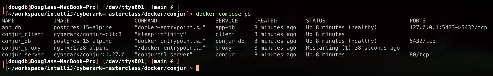
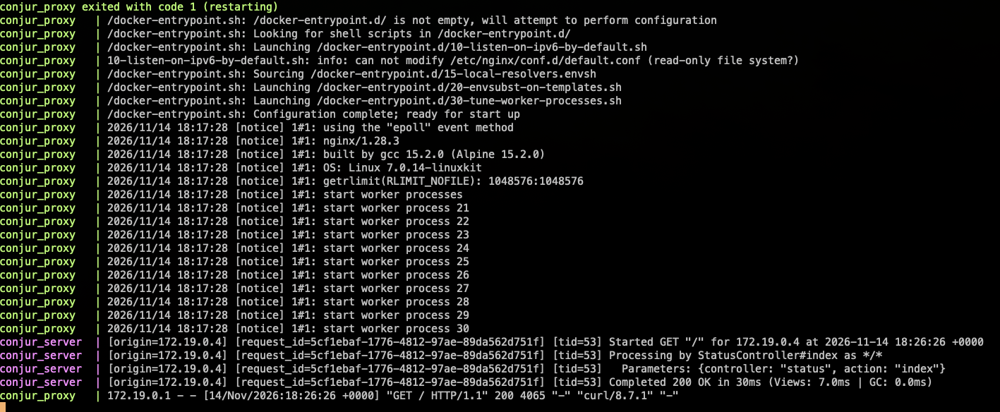
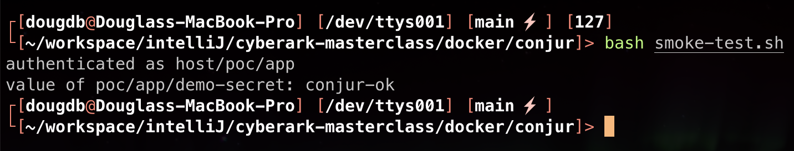
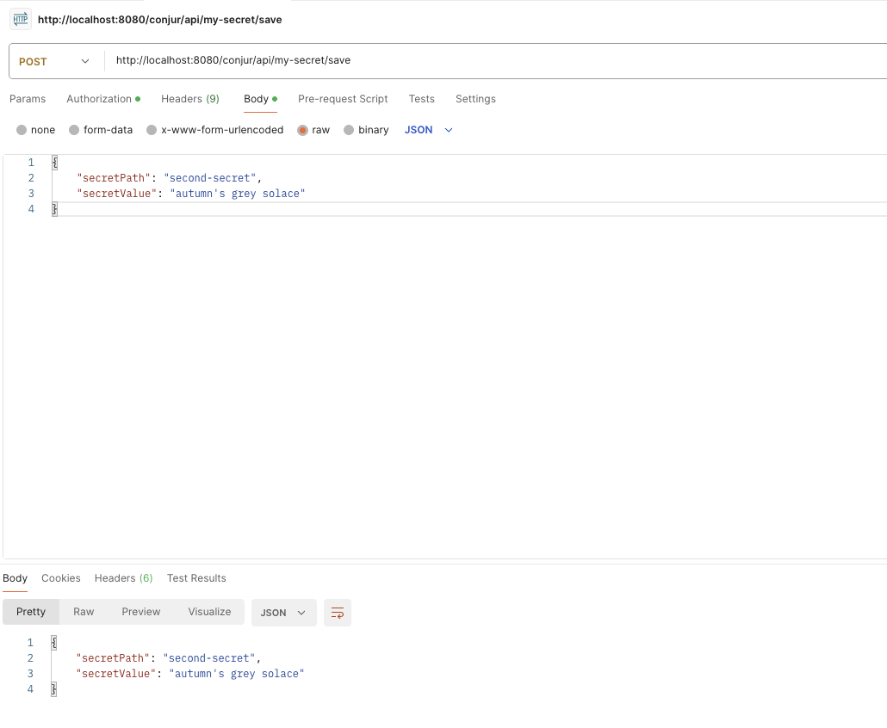

= CyberArk Conjur + Apache Camel: Integration PoC
Douglas Batista
:toc: left
:toclevels: 2
:icons: font
:source-highlighter: rouge

== 1. Objective

Validate, end to end, how a Spring Boot + Apache Camel application reads and writes secrets in an *external* CyberArk Conjur server using token-based, application-identity authentication.
The identity model mirrors the AppID / Safe / Object mindset used in the corporate CyberArk estate.

The PoC runs locally first (Maven on the Mac, Conjur in Docker) and is then migrated to OpenShift CRC.

.Success criteria
* The app authenticates against Conjur with a host identity and reads a secret through the Camel `cyberark-vault` component.
* The app creates/updates a secret value in Conjur through the same component.
* The same app runs on OCP CRC with credentials injected from a Kubernetes Secret into environment variables.
No credential lives in the image or in Git.
* Every phase is documented and reproducible.

== 2. Scope

[cols="1,1"]
|===
|In scope |Out of scope

a|
* Conjur OSS via Docker Compose (TLS proxy, pinned image tags)
* Camel `cyberark-vault` producer: `getSecret` and `createSecret`
* Migration to OpenShift CRC with Conjur external
a|
* Production hardening (HA, HSM, rotation, Conjur Enterprise/Followers)
* The corporate PAM/CCP (AIMWebService) API; it is a different API from Conjur's
* Persisting data in a database (JPA/PostgreSQL were dropped from the PoC)
|===

== 3. Target architecture

image::thumbs/main_conjur_arch.png[Initial architecture,align=center]

[cols="1,3"]
|===
|Component |Role

|MacOS host
|Runs Docker (Conjur) and OCP CRC. Phase 1-2 run the app directly with Maven.

|CyberArk Conjur OSS
|External secrets server (Docker Compose: Conjur, TLS proxy). Lives *outside* the cluster on purpose, like the corporate Vault.

|OCP CRC
|Single-node OpenShift. Runs the Spring Boot app Pod.

|Spring Boot app
|Apache Camel routes. Camel is the only layer that talks to Conjur.

|===

== 4. Core premises

. *Local first.* Validate everything with Maven + Docker before touching OCP.
. *Conjur stays external to the cluster*, reached through an endpoint on the host.
. *Camel is the only integration path to Conjur.* No hand-written HTTP client in business code.
. *No credentials in code, image or Git.* Environment variables locally; Kubernetes Secret injected as env vars on OCP.
. *Pinned image tags.* No `latest` in committed files.
Phase 1 pins `cyberark/conjur:1.27.0`, `postgres:15-alpine`, `nginx:1.28-alpine` and `cyberark/conjur-cli:8`.
. *TLS on by default.* The proxy uses a self-signed certificate and the JVM trusts it through a truststore (`javax.net.ssl.trustStore`).
The component option `certificatePath` had no effect in this setup (Camel 4.22.2), so it is not relied on. `verifySsl=false` stays as a fallback only.
. *Document each phase before starting the next.*

== 5. Identity and authentication

=== 5.1 Corporate model vs. Conjur model

[cols="1,1,2"]
|===
|Corporate CyberArk (CCP/AAM) |Conjur (this PoC) |Notes

|AppID
|Host identity (`host/<app>`)
|The application identity. Authenticates with an API key (or JWT) and receives a short-lived access token.

|Safe
|Policy branch (e.g. `poc/app`)
|Grouping and permission boundary. One branch holds many variables.

|Object / Account name
|Variable id (e.g. `poc/app/cipher-key`)
|The secret itself. A variable must be declared in policy before a value can be written to it.

|Account (tenant)
|Conjur account (e.g. `myConjurAccount`)
|Required by the Camel component (`account`).
|===

NOTE: If the corporate environment uses CCP/AAM, this PoC validates the Conjur model and the Camel integration pattern.
A CCP call would need a different component (for example `camel-http`).

=== 5.2 What the Camel component supports (4.22.x docs)

* Producer only (since Camel 4.17).
* Operations: `getSecret` (default) and `createSecret`, set in the URI or with header `CamelCyberArkVaultOperation`.
* `createSecret` takes the value from the message body and the id from header `CamelCyberArkVaultSecretId`. It sets the value of an *existing* variable; it does not create variables or policy branches (observed: HTTP 404 `not_found` for an undeclared variable).
* Secret id: URI option `secretId` or header `CamelCyberArkVaultSecretId`.
* Authentication: username + password, username + API key, or a pre-authenticated `authToken` (which takes precedence when present).
* Connection options: `url`, `account`, `verifySsl`, `certificatePath`, and `conjurClient` (a custom client bean from the registry).
* Property function: `+{{cyberark:path/to/var}}+` and `+{{cyberark:path#jsonField}}+`, fed by `CAMEL_VAULT_CYBERARK_*` environment variables.

=== 5.3 Authentication decision

[cols="1,2,1"]
|===
|Option |Description |Decision

|A. Host + API key
|`username=host/<app>` + `apiKey`, injected as env vars (K8s Secret on OCP). The component exchanges it for an access token.
|*Adopted* for phases 1-3

|B. Static `authToken`
|Token obtained outside the app and injected.
|Rejected: Conjur access tokens are short-lived

|C. `authn-jwt` with the Pod's service account token
|Custom `ConjurClient` bean that authenticates with the projected token. No long-lived secret in the cluster.
|Stretch goal (post phase 4)
|===

Observation: the stack trace of a failed call shows `retrieveSecret` calling `authenticate`, so the component seems to authenticate on each call. Token caching was not confirmed.

== 6. Application design

=== 6.1 Configuration contract

`application.yml` reads these environment variables; the local defaults point to the Docker Conjur, and OCP overrides them from a Kubernetes Secret.

[cols="2,3"]
|===
|Environment variable |Meaning

|`CAMEL_VAULT_CYBERARK_URL`
|Conjur base URL (TLS proxy)

|`CAMEL_VAULT_CYBERARK_ACCOUNT`
|Conjur account name

|`CAMEL_VAULT_CYBERARK_USERNAME`
|Host identity, e.g. `host/poc/app`

|`CAMEL_VAULT_CYBERARK_API_KEY`
|Host API key (from the Kubernetes Secret on OCP)
|===

=== 6.2 Flows

. *Read from Conjur* (implemented): REST `GET /conjur/api/my-secret/{name}` -> Camel route `direct:conjur-get` -> `cyberark-vault` `getSecret` on `poc/app/{name}` -> response.
. *Write to Conjur* (implemented): REST `POST /conjur/api/my-secret/save` with `{"secretPath": "...", "secretValue": "..."}` -> Camel route `seda:conjur-save` -> `cyberark-vault` `createSecret` on `poc/app/{secretPath}`.
The id is sent without a leading slash. The route is asynchronous, so a failed save only shows in the application log.

=== 6.3 Conjur policy

A policy file in the repo (`docker/conjur/policy/poc.yml`) declares the host (`poc/app`), the variables (`poc/app/cipher-key`, `poc/app/demo-secret`, `poc/app/second-secret`) and the permissions (`read`, `execute`, `update`) the host needs.

Responsibilities are split on purpose:

* *Admin / policy:* creates branches and variables and grants permissions.
* *Application (`host/poc/app`):* authenticates, reads and updates values on the variables it has permission for.

`createSecret` only succeeds on variables declared in the policy. To add a secret, add a `- !variable app/<name>` line to `poc.yml` and reload the policy.

== 7. Roadmap

[cols="1,3,1"]
|===
|Phase |Deliverable |Status

|1
|Conjur OSS in Docker Compose (pinned tags, TLS proxy, account, policy, host API key). Smoke test with curl.
|Done

|2
|Local app (`mvn spring-boot:run`): Camel `getSecret` / `createSecret`, integration tests with `mvn verify`.
|Done (manual tests; automated `mvn verify` tests pending)

|3
|Migration to OCP CRC: image to registry, Conjur reached from the Pod, credentials via Kubernetes Secret.
|Next

|4
|End-to-end tests and final documentation.
|Pending
|===

== 8. Repository layout

[source]
----
cyberark-masterclass/
├── pom.xml                  # parent: BOMs, plugins, shared dependencies
├── README.adoc
├── thumbs/                  # screenshots and architecture image
├── docker/
│   └── conjur/              # Conjur OSS stack (phase 1)
│       ├── docker-compose.yml
│       ├── conf/            # nginx proxy + openssl config
│       ├── policy/          # Conjur policy (poc.yml)
│       ├── smoke-test.sh    # host auth + read, via curl
│       ├── tls/             # generated certs and truststore (git-ignored)
│       ├── .env             # local secrets (git-ignored)
│       ├── admin_data       # admin API key (git-ignored)
│       └── poc_app_data     # host API key (git-ignored)
└── conjur/                  # Spring Boot + Camel module
    └── pom.xml
----

== 9. Open points

* Conjur OSS image tag: pinned to `1.27.0` (resolved in phase 1).
* `certificatePath` did not take effect with Camel 4.22.2; the JVM truststore is used instead (to be re-checked on OCP).
* How the Pod reaches the host from CRC (host endpoint name to be validated in phase 3).
* Whether the component caches the access token between calls (see 5.3).
* Optional extra: a separate provisioning identity (for example `host/poc/provisioner`) with policy permissions, so the application identity keeps access to secrets only.

== 10. Hands-on log (phases 1 and 2)

=== 10.1 Phase 1: Conjur OSS in Docker

.Local secrets, TLS certificate and stack (from `docker/conjur`)
[source,bash]
----
# Random DB passwords and the Conjur data key (git-ignored .env)
printf 'CONJUR_DB_PASSWORD=%s\nAPP_DB_PASSWORD=%s\n' "$(openssl rand -hex 16)" "$(openssl rand -hex 16)" > .env
printf 'CONJUR_DATA_KEY=%s\n' "$(docker run --rm cyberark/conjur:1.27.0 data-key generate)" >> .env

# Self-signed certificate for the proxy (SAN: localhost, proxy, 127.0.0.1)
mkdir -p tls && openssl req -x509 -newkey rsa:2048 -nodes -days 365 -keyout tls/conjur.key -out tls/conjur.crt -config conf/openssl.cnf

docker compose up -d
docker compose ps

# TLS check through the proxy, without -k
curl -sS --cacert tls/conjur.crt -o /dev/null -w '%{http_code}\n' https://localhost:8443/
----

image::thumbs/curl_cyberup_dckUP.png[TLS check returns 200]

.Conjur account and CLI (the admin API key goes to a git-ignored file)
[source,bash]
----
docker compose exec conjur conjurctl account create myConjurAccount > admin_data
docker compose exec client conjur init -u https://proxy -a myConjurAccount --self-signed
docker compose exec client conjur login -i admin
----

image::thumbs/conjur_docker-LoggedIn.png[Logged in as admin]

.Policy, host identity and smoke test
[source,bash]
----
# The host API key goes to a git-ignored file
docker compose exec client conjur policy load -b root -f /policy/poc.yml > poc_app_data

# Authenticates as host/poc/app and reads poc/app/demo-secret through the TLS proxy
bash smoke-test.sh
----

=== 10.2 Phase 2: read a secret through Camel

.Create a secret value, build the truststore and run the app
[source,bash]
----
# From docker/conjur
docker compose exec client conjur variable set -i poc/app/demo-secret -v "hello-from-conjur"
keytool -importcert -noprompt -alias conjur-poc -file tls/conjur.crt -keystore tls/conjur-truststore.p12 -storetype PKCS12 -storepass changeit

# From the conjur/ module (the truststore path is relative to the module directory)
mvn clean compile -DskipTests spring-boot:run -Dspring-boot.run.jvmArguments="-Djavax.net.ssl.trustStore=../docker/conjur/tls/conjur-truststore.p12 -Djavax.net.ssl.trustStorePassword=changeit -Djavax.net.ssl.trustStoreType=PKCS12"

curl localhost:8080/conjur/api/my-secret/demo-secret
----

image::thumbs/first_getPostmanEvidence.png[First GET evidence]

=== 10.3 Phase 2: write a secret through Camel

The variable must be declared in `poc.yml` before the first write; an undeclared id returns HTTP 404 `not_found`.

.Declare the variable, reload the policy and save a value
[source,bash]
----
# After adding "- !variable app/second-secret" to docker/conjur/policy/poc.yml (from docker/conjur).
# Do not redirect the output: it would overwrite poc_app_data.
docker compose exec client conjur policy load -b root -f /policy/poc.yml

curl -sS -X POST localhost:8080/conjur/api/my-secret/save -H 'Content-Type: application/json' -d '{"secretPath":"second-secret","secretValue":"<value>"}'

curl localhost:8080/conjur/api/my-secret/second-secret
----

image::thumbs/get_after_Create.png[GET returns the saved value]